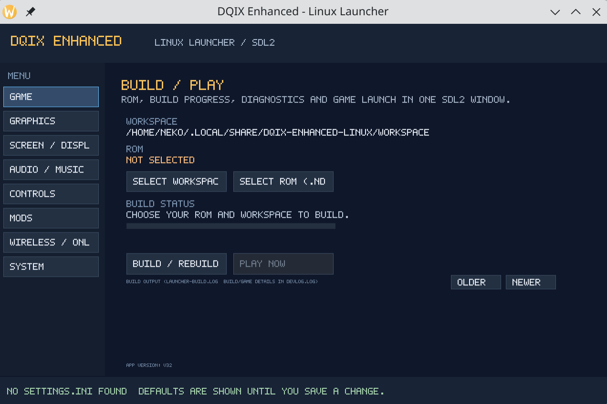
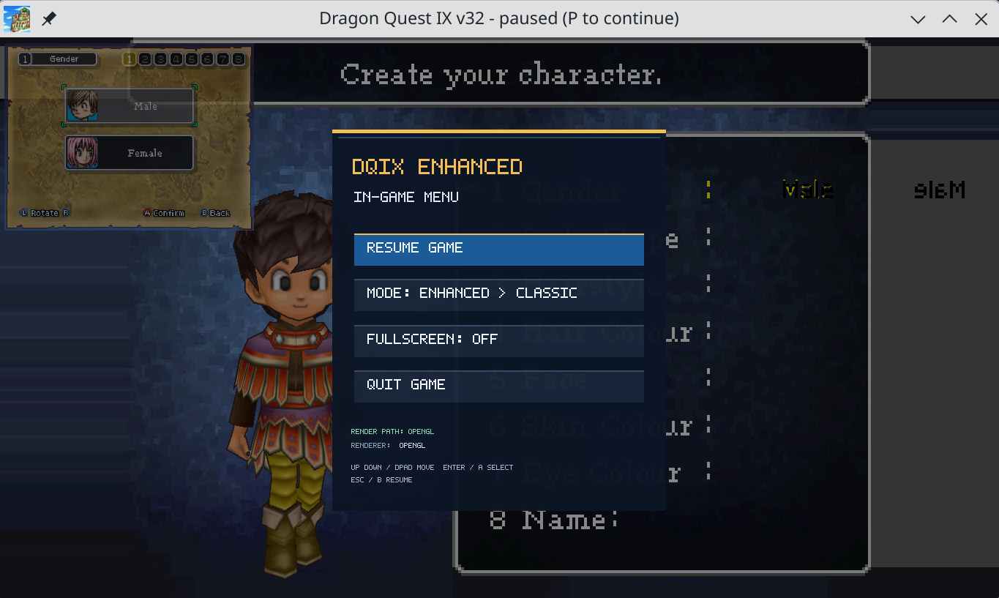
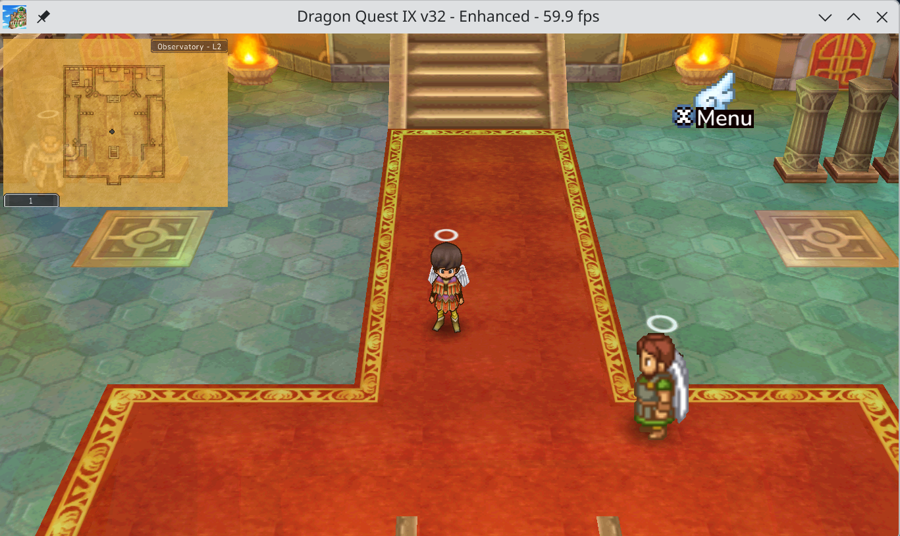

# Linux launcher and builder — SDL2

## Screenshots







## Architecture

The native Linux launcher uses the project's SDL2 stack and SDL_Renderer with a small project-owned UI. It does not use Dear ImGui, SDL3, Vulkan, SDL_ttf, GTK, Qt or Tk as its GUI toolkit. The same SDL2 window provides setup/build, progress/logs, settings, diagnostics and Play.

The in-game overlay is wired into the patch-derived Linux frontend: Escape, pause/resume, keyboard/gamepad navigation, and GL plus SDL_Renderer drawing paths are implemented. The 512×768 menu canvas now preserves its aspect ratio on resize/fullscreen; a separate pass dims the whole window, and mouse clicks use the same fitted rectangle. OpenGL library loading is diagnosed explicitly. When SDL auto-selects Wayland and GL-window creation fails, the frontend retries via X11/XWayland if `DISPLAY` exists and the user did not explicitly set `SDL_VIDEODRIVER`; it restores Wayland if the retry fails. Live-game acceptance remains pending for input capture, focus loss, fullscreen, shutdown and both renderer paths; see `IN_GAME_OVERLAY_GATE.md`.

## Implementation

- `ui/launcher_main.cpp` draws the UI with SDL_Renderer and an embedded 5x7 bitmap font. Keyboard, mouse and basic gamepad navigation are supported.
- The Game page offers ROM and workspace selection via an in-app file/folder browser with path entry, plus build status/progress, scrollable recent output and Play Now.
- `builder/build_job.cpp` validates ROM/workspace paths, confirms merging non-empty unmarked workspaces, stages project sources while excluding generated/private output, and protects against writes through destination symlinks.
- Source staging and compilation run outside the SDL render/event loop. `BuildJob` captures combined build output, sends events to the UI and persists the raw build transcript at `launcher-build.log`. It also mirrors timestamped build messages into workspace-root `devlog.log`.
- After a successful build, the launcher validates the generated game layout and launches via `game/play.sh` when present, with a direct-executable fallback. Game stdout/stderr are appended to workspace-root `devlog.log` under a timestamped session header. The patched Linux frontend emits a structured `renderer-diagnostics` block with fallback state/reason, SDL/video/window/display details, OpenGL vendor/renderer/version/context attributes or SDL_Renderer name/capabilities/formats/errors/output size and texture details. `game/launcher.log` remains the launcher/settings log. If `devlog.log` cannot be opened, output falls back to `launcher.log` and the UI reports the fallback.
- Enhanced OpenGL host compatibility is handled by `tools/linux-gl-compat.sh`: when `$DISPLAY` is available and `SDL_VIDEODRIVER` is unset or already `x11`, `AppRun` resolves host X11/XCB/DRM libraries into a cache-only override directory, while the game child receives `LD_PRELOAD`, the override-first `LD_LIBRARY_PATH`, `SDL_VIDEODRIVER=x11` and `SDL_VIDEO_X11_FORCE_EGL=0`. An explicit different SDL video driver and headless launches are left alone. The SDL2 builder UI itself is not forced onto X11. The generated `game/play.sh` also applies the helper when launched directly. A manual Intel Mesa test confirmed `game_renderer_fallback=false`, `render_path=OpenGL + gl_render` and `game_mode=enhanced`; the rebuilt AppImage still needs an end-to-end retest.
- Graphics/display/audio/controls/mods/wireless/system pages remain. The launcher edits a subset of runtime settings; controls remapping and free-form server/player text entry are not implemented there yet. See `FEATURE_PARITY_AUDIT.md` for the exact coverage and Vulkan assessment. Saving a setting is not proof the runtime applies it.
- `packaging/linux/AppRun` checks the bundled toolchain as before and starts the SDL2 launcher directly. The former Tk app `packaging/linux/gui.py` is deleted from the branch and excluded by the AppImage payload policy. The build toolchain still contains Python for code generation/build/package tasks; this does not create a Tk UI.
- Canonical Windows/runtime sources, root `build.mk` and root `tools/build-game.sh` remain unchanged. Ordered patches, `source-mirror-manifest.json`, `tools/sync_linux_sources.py` and checked-in mirrors under `src/` define the Linux-only build path.

## Verification

Full temporary E2E run [40842120096](https://github.com/rakmahefa/dqix-enhanced/actions/runs/40842120096) passed all three jobs on the aspect-fit overlay revision. Source-mirror regeneration applied all six ordered patches without fuzz and matched canonical/mirror hashes; the Makefile-driven frontend/overlay builds and all five CTest cases passed.
- The native SDL2 job compiles the patched frontend plus `linux_overlay.o` and `linux_overlay_gl.o` through the actual Linux Makefile rules and passes all five CTest cases.
- The locked Conda SDL2 launcher build passes. The x86_64 AppImage passes cold/warm startup, integrated launcher self-test, corrupt-toolchain rejection and payload checks.
- ELF audit: 718 ELF files, zero findings; SBOM: 96 Conda components.

Artifacts: [AppImage](https://github.com/rakmahefa/dqix-enhanced/actions/runs/40842120096/artifacts/12882774555) · [E2E diagnostics](https://github.com/rakmahefa/dqix-enhanced/actions/runs/40842120096/artifacts/12883587104) · [SDL2 toolchain diagnostics](https://github.com/rakmahefa/dqix-enhanced/actions/runs/40842120096/artifacts/12883760187) · [Linux development diagnostics](https://github.com/rakmahefa/dqix-enhanced/actions/runs/40842120096/artifacts/12883471218).

Those CI checks do not run a real ROM-backed game; live renderer, overlay and settings behavior still need manual acceptance. See `FEATURE_PARITY_AUDIT.md` for the settings coverage and Vulkan assessment.

The user has confirmed the AppImage builds and launches the game with a real ROM/workspace. The new capture has automated child-process coverage; one real game run should still confirm the precise renderer diagnostics emitted by the user's build. The permanent production AppImage workflow has not yet been confirmed on an allowed trigger.

## Build and test locally

Install SDL2 development files, CMake, Ninja, a C++17 compiler and pkg-config:

```sh
cmake -S third_party/extra/linux -B build-linux-ui -G Ninja -DCMAKE_BUILD_TYPE=Debug
cmake --build build-linux-ui --verbose
ctest --test-dir build-linux-ui --output-on-failure
```

The six CTest cases cover builder dry-run success/failure and launch-environment propagation, overlay raster and aspect-fit geometry, settings-model/runtime-mirror schema parity, launcher CLI help, OpenGL compatibility helper shell syntax, and a hidden SDL2 software-renderer smoke test. They require no real ROM or desktop GPU and do not prove a ROM-backed game boots.

## Launcher arguments

```sh
dqix-linux-ui-launcher \
  --source-root /path/to/bundled/source \
  --default-workspace "$HOME/.local/share/dqix-enhanced-linux/workspace" \
  --version 1.2.3
dqix-linux-ui-launcher --game-dir /absolute/path/to/game
dqix-linux-ui-launcher --help
dqix-linux-ui-launcher --self-test
```

The integrated AppImage path passes the first group of arguments automatically. Before Play, the game directory must contain an executable `dqix`, `data/dqix.nds` and `data/code/`. No game binary, ROM, save or generated game asset is bundled.

## Patch-derived Linux source mirror

The builder requires `third_party/extra/linux/src/tools/build-game.sh`; it selects the mirrored makefile and frontend with no fallback to root scripts. Use `python3 third_party/extra/linux/tools/sync_linux_sources.py --sync` during development, then commit mirrors, patches and updated manifest together. CI runs `--check`; the AppImage consumes reviewed checked-in copies and never writes into its read-only source tree.

## Remaining manual checks

1. With the updated AppImage, check workspace-root `devlog.log` for the timestamped session header, the runtime's stdout/stderr, SDL/OpenGL messages and exit status. `devlog.log` records diagnostics the runtime already emits; it does not export every frame's in-memory performance counters.
2. Confirm the production AppImage workflow on its intended trigger.
3. Verify the renderer diagnostic block with the updated AppImage. Validate Escape/pause, keyboard/gamepad input, aspect ratio on fullscreen/resized windows, GL and SDL_Renderer fallback before marking the gate passed.
